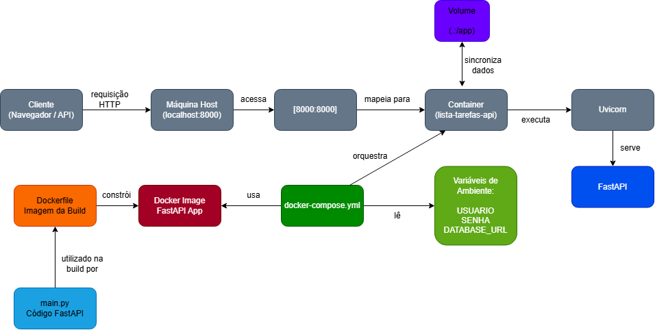

# Lista de Tarefas

API REST desenvolvida com FastAPI para gerenciamento de tarefas.

## Funcionalidades

- Adicionar, listar e remover tarefas;
- Marcar tarefa como concluída;
- Autenticação HTTP Basic;
- Persistência em SQLite;
- Containerização com Docker e Docker Compose;
- Gerenciamento de dependências com Poetry

## Tecnologias Utilizadas

- Python 3.14;
- FastAPI;
- SQLAlchemy;
- SQLite;
- Poetry;
- Docker
- Docker Compose

## Fluxo de containerização



### Critério de Utilização das Cores

#### Azul Claro e Escuro - Código e Aplicação

Utilizado para os componentes diretamente relacionados ao desenvolvimento da aplicação:

- `main.py`: representa o código-fonte da API FastAPI;
- FastAPI: representa a aplicação em execução dentro do container.

#### Laranja - Processo de Build

Utilizado no `Dockerfile` para representar a etapa de construção (build), já que ele contém as instruções responsáveis por transformar o código-fonte em uma imagem Docker.

#### Vermelho - Imagem Gerada

Utilizado na `Docker Image`. A imagem é o resultado do processo de build e representa a intermediação entre o código e o container em execução. A cor diferente foi utilizada para diferenciar visualmente tanto do processo de build quanto da execução.

#### Verde Claro e Escuro (Configuração e Orquestração)

Utilizado em:

- `docker-compose.yml`;
- Variáveis de Ambiente.

A cor verde identifica elementos relacionados à configuração e ao gerenciamento da aplicação.

O arquivo `docker-compose.yml` é responsável pela orquestração dos containers e pelas configurações de execução.

As variáveis de ambiente armazenam parâmetros externos da aplicação, como as credenciais de acesso às requisições HTTP e o endereço do banco de dados.

#### Cinza (Infraestrutura e Execução)

Utilizado em:

- Cliente;
- Máquina Host;
- Mapeamento de Porta [8000:8000];
- Container;
- Uvicorn.

Esses elementos compõem a infraestrutura necessária para a execução da aplicação e para o fluxo de requisições HTTP. A cor foi utilizada para representar componentes de suporte e execução, sem destaque para a lógica de negócio.

#### Roxo (Persistência e Sincronização)

Utilizado em Volume (`.:/app`). Representa armazenamento, persistência e sincronização de arquivos entre a máquina host e o container.

### Componentes Representados

#### main.py

Arquivo principal da aplicação.

Contém:

- Configuração da FastAPI;
- Endpoints da API;
- Integração com SQLAlchemy;
- Autenticação HTTP Basic;
- Regras de negócio da aplicação.

#### Dockerfile

Arquivo responsável por definir as instruções necessárias para construir a imagem Docker da aplicação.

Durante o processo de build, o Dockerfile:

- Utiliza uma imagem Python como base;
- Instala o Poetry;
- Instala as dependências do projeto;
- Copia os arquivos da aplicação para a imagem;
- Define o comando de inicialização do servidor Uvicorn.

#### Docker Image

Resultado do processo de build realizado pelo Dockerfile.

A imagem contém:

- Python;
- Poetry;
- FastAPI;
- SQLAlchemy;
- Código-fonte da aplicação.

Essa imagem vai servir como base para a criação dos containers.

#### docker-compose.yml

Arquivo responsável por orquestrar a execução da aplicação.

Suas principais funções são:

- Criar o container a partir da imagem Docker;
- Configurar o mapeamento de portas;
- Carregar variáveis de ambiente;
- Definir volumes;
- Gerenciar a execução do container.

#### Variáveis de Ambiente

São informações de configuração da aplicação e dados sensíveis.

Neste caso, tratam-se de credenciais de acesso às requisições HTTP e endereço do banco de dados.

Essas variáveis são carregadas pelo Docker Compose e utilizadas pela aplicação durante a execução.

#### Volume

O volume configurado (`.:/app`) sincroniza os arquivos do projeto local com os arquivos que estão dentro do container.

Isso permite que alterações realizadas no código sejam refletidas imediatamente durante o desenvolvimento.

#### Container

O container é criado pelo Docker Compose utilizando a imagem Docker anteriormente construída.

Dentro do container são executados:

- Uvicorn;
- FastAPI.

#### Uvicorn

Servidor responsável por executar a aplicação FastAPI.

Ele recebe as requisições HTTP encaminhadas ao container e as direciona para a aplicação.

#### FastAPI

Framework utilizado no desenvolvimento da API REST.

Responsável pelo processamento das requisições HTTP, aplicação das regras de negócio e retorno das respostas ao cliente;

### Fluxo de Containerização

O fluxo ocorre da seguinte maneira:

1. O desenvolvedor implementa a aplicação no arquivo `main.py`;
2. O Dockerfile utiliza esse código para construir uma imagem `Docker`;
3. A imagem gerada passa a conter todos os componentes necessários para a execução da aplicação;
4. O `docker-compose.yml` utiliza essa imagem e cria um container;
5. O container executa o servidor Uvicorn;
6. O Uvicorn disponibiliza a aplicação FastAPI para acesso externo.

### Fluxo da Requisição

O fluxo de uma requisição segue as etapas abaixo:

1. Um cliente (pode ser navegador, documentação Swagger ou ferramentas como Postman ou Insomnia) envia uma requisição HTTP;
2. A requisição chega à máquina host através do endereço `localhost:8000`;
3. O mapeamento de portas (`8000:8000`) encaminha a requisição para o container;
4. O Uvicorn recebe a requisição;
5. O FastAPI processa a solicitação;
6. A resposta retorna para o cliente.

## Passos para clonar e rodar

```bash
git clone https://github.com/tayanibritto/lista-tarefas-python.git
```

```bash
cd lista-tarefas-python
```

Criar o arquivo .env na raiz do projeto:

```env
USUARIO=seu_usuario
SENHA=sua_senha
DATABASE_URL=sqlite:///./tarefas.db
```

### Usuários de Docker Compose:

```bash
docker-compose up --build -d
```

ou

```bash
docker compose up --build -d
```

Acessar a documentação Swagger para testar a aplicação:

```text
http://localhost:8000/docs
```

Para parar a aplicação:

```bash
docker-compose down
```

ou

```bash
docker compose down
```

### Usuários de Podman Compose:

```bash
podman-compose up --build -d
```

ou

```bash
podman compose up --build -d
```

Acessar a documentação Swagger para testar a aplicação:

```text
http://localhost:8000/docs
```

Para parar a aplicação:

```bash
podman-compose down
```

ou

```bash
podman compose down
```

## Endpoints da aplicação

### Criar tarefa

```http
POST /adicionar_tarefa
```

### Listar todas as tarefas cadastradas

```http
GET /tarefas
```

### Marcar tarefa como concluída

```http
PUT /marcar_concluida/{nome}
```

### Excluir tarefa

```http
DELETE /remover_tarefa/{nome}
```

## Estrutura do Projeto

```text
.
├── public/
│   └── diagrama.png
├── Dockerfile
├── docker-compose.yml
├── main.py
├── pyproject.toml
├── poetry.lock
├── tarefas.db
└── README.md
```

## Observação

Este projeto foi testado utilizando o Podman Compose.